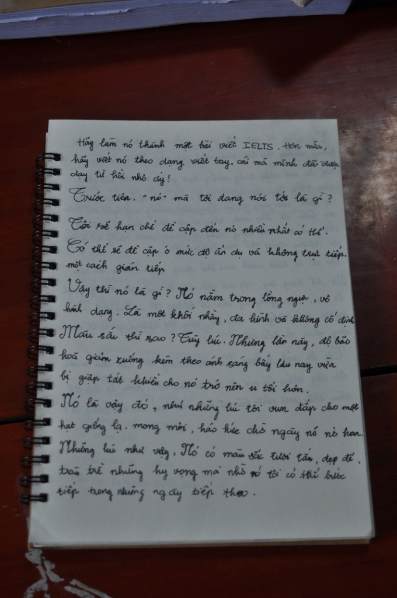
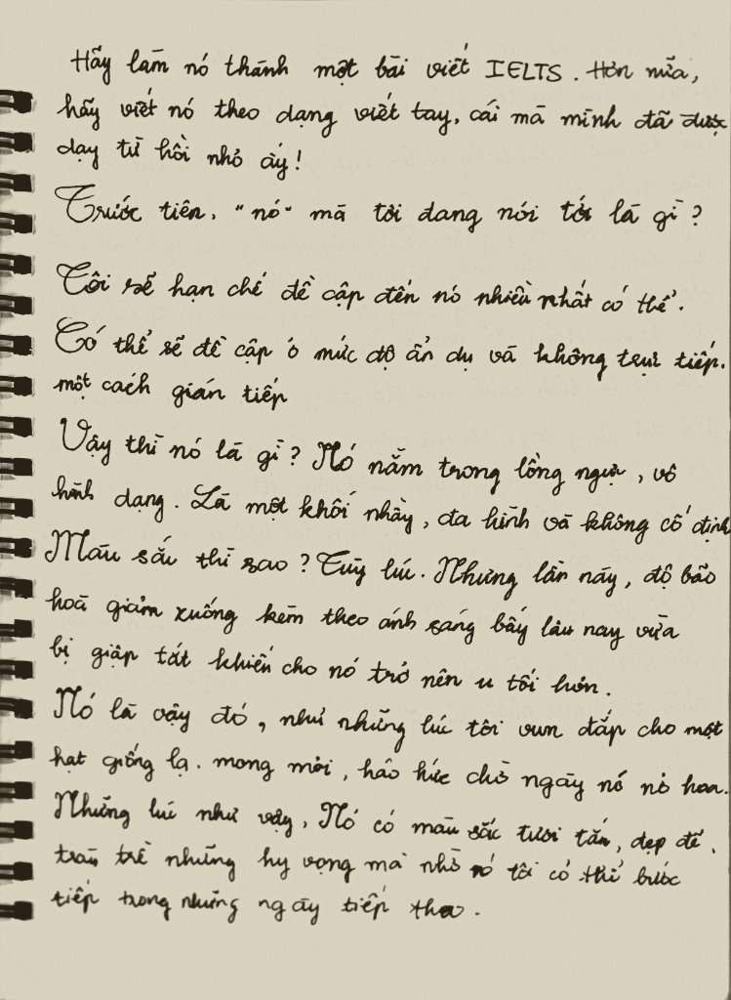

# Digital Post Letter Processing Worker

[English](README.md) | [Tiếng Việt](README_VI.md)

A standalone, deterministic Python worker and pipeline engine for handwritten letter photo enhancement, boundary detection, perspective rectification, illumination correction, ink-and-paper separation, and quality assurance.

Designed strictly without OCR or text interpretation, separating computer vision processing from UI/API orchestration.

> 📘 **Tài liệu hướng dẫn sử dụng & tích hợp đầy đủ**: Xem chi tiết tại [USAGE.md](USAGE.md).

---

## Demonstration (Before & After)

| 📷 Ảnh chụp gốc (Before) | ✨ Phục chế Vintage (After) |
| :---: | :---: |
|  |  |
| *Ảnh chụp nghiêng, bóng tối loang lổ, chữ hằn trang sau* | *Nắn thẳng phối cảnh 3D, sạch nền, giữ sắc ngà & vân giấy* |

---

## 1. Architecture & Pipeline Overview

```
[Raw Photo]
    │
    ▼
01. Load & Validate (EXIF orientation, size/pixel limits, RGB decode)
    │
    ▼
02. Detect Paper (Multi-pass Canny + Otsu contours, quad scoring & ranking)
    │
    ├─► Confidence < 0.80 ──► [awaiting_corners] (API prompts user confirmation)
    │                                │ (User confirms corners)
    │                                └─────────┐
    ▼                                          ▼
03. Perspective Rectification (Homography transform, dynamic aspect scaling)
    │
    ▼
04. Illumination Correction (Low-frequency background field estimation & division)
    │
    ▼
05. Ink & Paper Separation (Pure B&W, Natural, or Vintage preset restoration)
    │
    ▼
06. Quality Assurance (Blur scoring, pixel distribution, ink coverage, integrity)
    │
    ▼
07. Atomic Persist (Temporary write, verification, atomic replace, sidecar metadata)
```

---

## 2. Restoration Presets

| Preset | Description | Output Format | Best For |
|---|---|---|---|
| **Pure B&W** (`pure_bw`) | Strict binarization (Adaptive Gaussian or Otsu) producing crisp dark ink on pure white paper. | 2D Binary PNG (0 or 255) | High-contrast documents, clean archival copies |
| **Natural** (`natural`) | Multi-level grayscale with illumination normalization, CLAHE contrast enhancement, and background whitening. | 2D Grayscale PNG | Handwritten letters, light pencil strokes, fountain pen gradients |
| **Vintage** (`vintage`) | Warm ivory parchment tone (`#F5EEDE`) with aged sepia ink (`#2A2018`) and organic paper texture preservation. | 3D RGB PNG | Historic aesthetics, nostalgic handwritten letters |

---

## 3. Parameter & Configuration Reference

### 3.1 Environment Variables / Global Configuration

Configured in `letter_worker.config.WorkerConfig` or via environment variables:

| Variable | Type | Default | Description |
|---|---|---|---|
| `STORAGE_ROOT` | string / path | `.` (current dir) | Sandbox root directory. Prevents path traversal attacks (`../`). |
| `DATABASE_PATH` | string / path | `letter_worker.db` | SQLite database file location for job queue and progress tracking. |
| `MAX_IMAGE_FILE_SIZE_BYTES` | integer | `52428800` (50 MB) | Maximum upload file size allowed. |
| `MAX_IMAGE_PIXELS` | integer | `50000000` (50 MP) | Maximum pixel area ($W \times H$) to guard against decompression bombs. |
| `MAX_OUTPUT_DIMENSION` | integer | `8192` | Maximum width or height of rectified image (auto-scaled down if exceeded). |
| `CONFIDENCE_AUTO_ACCEPT` | float | `0.80` | Confidence threshold $\ge 0.80$ will automatically proceed with detected corners. |
| `CONFIDENCE_AWAIT_CONFIRMATION` | float | `0.50` | Confidence between $0.50$ and $0.79$ halts at `awaiting_corners` with suggested corners. |
| `JOB_LEASE_TIMEOUT_SECONDS` | integer | `300` (5 min) | Stale job timeout before reclaiming a job if a worker crashes. |
| `JOB_MAX_ATTEMPTS` | integer | `3` | Maximum retry attempts for transient failures before marking as permanently failed. |
| `POLL_INTERVAL_SECONDS` | float | `1.5` | Sleep interval in seconds when worker finds no pending jobs. |
| `WORKER_ID` | string | `worker-<pid>` | Unique identifier for the worker process instance. |

---

### 3.2 Job Settings (`RestoreSettings`)

Parameters passed in `job.settings`:

| Parameter | Type | Options / Range | Default | Explanation |
|---|---|---|---|---|
| `preset` | string | `"pure_bw"`, `"natural"`, `"vintage"` | `"natural"` | Overall aesthetic rendering style. |
| `aspect_ratio` | string | `"auto"`, `"a4"`, `"notebook"`, `"letter"`, `"free"` | `"auto"` | Aspect ratio mode. `"auto"` recovers true 3D physical proportions using vanishing geometry (MSR-TR-2003-39) to eliminate horizontal/vertical stretching from tilted camera angles. |
| `paper_warmth` | float | `0.0` to `1.0` | `0.75` | Warmth of aged paper patina in vintage preset: `0.0` (clean light cream) to `0.75` (authentic warm golden ivory) to `1.0` (deep antique parchment). |
| `bleed_through_reduction` | float | `0.50` to `0.98` | `0.82` | White-point ratio to suppress faint show-through writing from back page of thin notebook paper. |
| `margin_inset` | float | `0.0` to `0.10` | `0.0` | Inward margin crop fraction to cleanly eliminate spiral wire bindings, punch holes, or desk edges. |
| `denoise` | string | `"off"`, `"light"`, `"medium"` | `"light"` | Degree of stroke-preserving denoising. `"light"` uses bilateral filter ($d=5$); `"medium"` uses Fast Non-Local Means. |
| `threshold_method` | string | `"adaptive"`, `"otsu"` | `"adaptive"` | Binarization algorithm (used only when preset is `pure_bw`). |
| `threshold_strength` | float | `0.0` to `1.0` | `0.5` | Threshold sensitivity. Lower values produce bolder strokes; higher values produce thinner, lighter strokes. |
| `adaptive_block_size` | integer (odd) | e.g. `15, 25, 35` | `None` (auto) | Custom neighborhood block size. When `None`, auto-calculated proportional to image diagonal. |
| `adaptive_c` | float | e.g. `5.0 - 20.0` | `None` (auto) | Custom offset subtracted from weighted mean. When `None`, derived as $4.0 + 12.0 \times \text{threshold\_strength}$. |

---

### 3.3 Corner Geometry (`corners`)

- **Format**: `list[Point]` or `[[x, y], [x, y], [x, y], [x, y]]`
- **Coordinate Space**: Based on the EXIF-normalized image (top-left is $[0, 0]$), prior to any preview resizing.
- **Ordering**: Automatically sorted clockwise by the worker:
  `[0: top-left, 1: top-right, 2: bottom-right, 3: bottom-left]`
- If `corners = None`, the worker executes automatic paper contour detection.

---

### 3.4 Progress Stages & Message Codes

Workers emit `JobProgressEvent` updates for the UI to show interactive librarian dialogs:

| Stage | Progress | `message_code` | User-facing Explanation (Librarian Context) |
|---|---|---|---|
| `loading` | 10% | `IMAGE_LOADING` | Đang đọc ảnh và kiểm tra độ phân giải an toàn... |
| `detecting` | 25% | `CORNER_DETERMINATION` | Đang phân tích góc giấy và đường viền trang thư... |
| `detecting` | 35% | `USING_USER_CORNERS` | Đang căn chỉnh theo 4 góc do người dùng xác nhận... |
| `awaiting_corners` | 40% | `AWAITING_CORNER_CONFIRMATION` | Cần người dùng kiểm tra và xác nhận lại 4 góc giấy. |
| `rectifying` | 50% | `PERSPECTIVE_RECTIFICATION` | Đang làm phẳng phối cảnh và kéo vuông góc trang thư... |
| `restoring` | 75% | `RESTORATION_APPLIED` | Đang khử bóng đổ, làm sạch trang và tách nét mực... |
| `quality_check` | 90% | `QUALITY_ASSURANCE` | Đang kiểm định độ sắc nét và tính toàn vẹn của nét chữ... |
| `completed` | 100% | `PROCESSING_COMPLETED` | Phục chế hoàn tất! Bản scan sạch đã sẵn sàng. |
| `failed` | 100% | *(error_code)* | Gặp sự cố trong quá trình xử lý. |

---

### 3.5 Quality Assurance Output (`QualityCheckResult`)

Every completed job produces quality metrics stored in `{job_id}_metadata.json`:

- `status`:
  - `"passed"`: All checks passed smoothly.
  - `"warning"`: Minor warnings raised (usable image, but flagged for user attention).
  - `"rejected"`: Image unreadable or blank (fails processing).
- `blur_score`: Variance of Laplacian. Scores $< 35.0$ indicate blurry or out-of-focus capture.
- `ink_coverage`: Proportion of dark ink pixels. Normal letters range between $0.5\%$ and $40\%$.
- Potential QA warning reasons:
  - `POTENTIAL_BLUR`: Sharpness score is below threshold.
  - `LOW_INK_COVERAGE`: $< 0.05\%$ ink detected (possible blank page).
  - `EXCESSIVE_DARK_COVERAGE`: $> 65\%$ dark pixels (incorrect threshold or dark photo).
  - `SOLID_WHITE_IMAGE`: Solid white canvas with no contrast.
  - `SOLID_BLACK_IMAGE`: Solid black canvas.

---

## 4. Integration Guide with Other Applications

This worker is designed to integrate seamlessly with external Web APIs (Node.js/Express, Python FastAPI, Next.js, Go) and frontend user interfaces.

### Integration Pattern A: Shared SQLite Queue (Recommended for MVP / Monolith)

Both the Web API and Python Worker run on the same server, sharing the storage folder and `letter_worker.db`:

```
┌─────────────────┐       HTTP Upload       ┌─────────────────┐
│ Frontend UI     │ ──────────────────────► │ Web API         │
│ (Next.js / Vue) │ ◄────────────────────── │ (Node / FastAPI)│
└─────────────────┘      Job Status / SSE   └────────┬────────┘
         ▲                                           │
         │                                           │ 1. Enqueue Job
         │                                           ▼
         │                                  ┌─────────────────┐
         │                                  │ letter_worker.db│
         │                                  │ (SQLite Queue)  │
         │                                  └────────┬────────┘
         │                                           │
         │ 2. Polling / SSE Status                   │ 3. Atomic Claim
         │                                           ▼
         │                                  ┌─────────────────┐
         └───────────────────────────────── │ Python Worker   │
             Displays progress / corners    │ (Worker Daemon) │
                                            └─────────────────┘
```

#### Step 1: Web API enqueues job
```sql
INSERT INTO jobs (
    job_id, status, stage, progress, message_code,
    input_path, output_dir, settings_json, max_attempts, created_at
) VALUES (
    'job_abc123', 'queued', 'queued', 0, 'QUEUED',
    'uploads/letter_01.jpg', 'outputs',
    '{"preset": "vintage", "denoise": "light", "threshold_strength": 0.5}',
    3, datetime('now')
);
```

#### Step 2: Web API tracks job status
```sql
SELECT status, stage, progress, message_code, output_path, metadata_path, corners_json
FROM jobs
WHERE job_id = 'job_abc123';
```

#### Step 3: Handling the `awaiting_corners` flow in Frontend
When `status == "awaiting_corners"`:
1. Web API retrieves `corners_json` containing proposed corner coordinates:
   ```json
   [{"x": 120.0, "y": 85.0}, {"x": 780.0, "y": 110.0}, {"x": 740.0, "y": 690.0}, {"x": 105.0, "y": 640.0}]
   ```
2. Frontend renders the raw photo on a canvas and places 4 interactive draggable corner handles.
3. User adjusts the corners and clicks **"Confirm Corners"**.
4. Frontend posts updated coordinates to Web API.
5. Web API confirms corners and resets status to `'queued'`:
   ```sql
   UPDATE jobs
   SET status = 'queued',
       stage = 'queued',
       progress = 0,
       message_code = 'CORNERS_CONFIRMED',
       corners_json = '[{"x": 130, "y": 90}, ...]'
   WHERE job_id = 'job_abc123';
   ```
6. The Worker claims the job again and immediately skips detection, proceeding directly to rectification and restoration!

---

### Integration Pattern B: Direct Python Library (Embedded in FastAPI / Celery)

If your API is written in Python (FastAPI, Celery, Lambda, Django), you can run processing directly in-process without the SQLite daemon:

#### Approach 1: High-level `process_letter` function
```python
from letter_worker import process_letter

# Direct in-memory restoration (accepts file path, PIL Image, or NumPy array)
restored_rgb, metadata = process_letter(
    image="uploads/letter.jpg",
    preset="vintage",              # "pure_bw", "natural", "vintage"
    aspect_ratio="auto",           # "auto", "a4", "notebook", "letter", "free"
    paper_warmth=0.75,             # 0.0 (light cream) to 1.0 (antique parchment)
    bleed_through_reduction=0.82,  # suppresses faint show-through text from back page
    margin_inset=0.01,             # trims spiral holes or dirty borders
    output_path="outputs/restored.png",
)

print("Dimensions:", metadata["output_dimensions"])
print("QA Status:", metadata["quality"]["status"])
```

#### Approach 2: Stateful `LetterProcessor` with progress events
```python
from letter_worker import LetterProcessor, LetterJob, RestoreSettings, Point, WorkerConfig

processor = LetterProcessor(WorkerConfig(storage_root="./data"))

job = LetterJob(
    job_id="job_fastapi_001",
    input_path="uploads/letter.jpg",
    output_dir="outputs",
    corners=[Point(x=100, y=80), Point(x=700, y=90), Point(x=680, y=600), Point(x=90, y=580)],
    settings=RestoreSettings(preset="vintage", aspect_ratio="auto", paper_warmth=0.75),
)

def on_progress(event):
    print(f"[{event.progress}%] {event.stage}: {event.message_code}")

result = processor.process(job, on_progress=on_progress)
print("Output file:", result.output_path)
print("QA status:", result.quality.status)
```

---

### Integration Pattern C: CLI Subprocess / Docker

Call the CLI directly from Node.js, Go, or PHP:

```bash
uv run python main.py process uploads/photo.jpg \
  --output-dir ./outputs \
  --preset natural
```

Output is printed as clean JSON to stdout:
```json
{
  "job_id": "cli_1773901234",
  "status": "completed",
  "output_path": "outputs/cli_1773901234_natural.png",
  "metadata_path": "outputs/cli_1773901234_metadata.json",
  "confidence": 0.89,
  "quality": {
    "status": "passed",
    "blur_score": 142.5,
    "ink_coverage": 0.084,
    "width": 1240,
    "height": 1754
  },
  "duration_seconds": 0.84
}
```

---

## 5. Quick Start & CLI Usage

### Prerequisites
- Python 3.11+
- [uv](https://docs.astral.sh/uv/) package manager

### Run Unit & Integration Tests (52 tests)
```bash
uv run pytest -v
```

### CLI Subcommands
```bash
# Start Worker Daemon
uv run python main.py worker --db ./letter_worker.db --storage .

# Initialize SQLite database
uv run python main.py init-db --db ./letter_worker.db

# Enqueue a job into DB
uv run python main.py enqueue job_001 photo.jpg --output-dir ./output --preset vintage --db ./letter_worker.db

# Check status of a job
uv run python main.py status job_001 --db ./letter_worker.db

# Process one-shot directly without DB
uv run python main.py process photo.jpg --output-dir ./output --preset natural
```

---

## 6. Docker Deployment

Build container:
```bash
docker build -t letter-worker:latest .
```

Run worker container with persistent volume:
```bash
docker run -d \
  --name letter-worker \
  -v /path/to/data:/app/data \
  -e STORAGE_ROOT=/app/data \
  -e DATABASE_PATH=/app/data/letter_worker.db \
  letter-worker:latest
```
